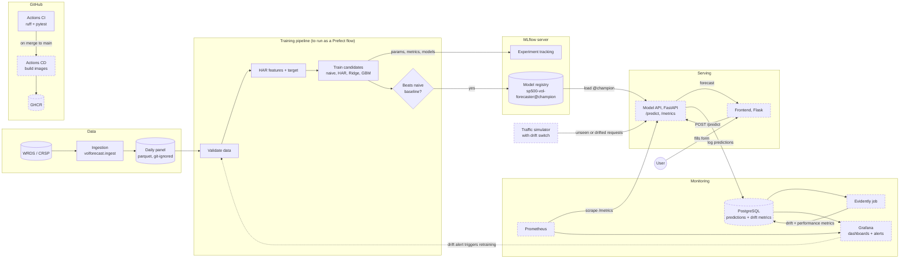

# S&P 500 Volatility Forecasting: an end-to-end MLOps system

[](https://github.com/yszgit/sp500-vol-mlops/actions/workflows/ci.yml)

INSY 684 group project (McGill, Fall 2026). The focus is MLOps: a reproducible training
pipeline, experiment tracking, a model registry, containerized serving, monitoring and CI/CD.

## Problem

**Forecast each S&P 500 stock's realized volatility over the next trading week.**
Volatility forecasts drive risk limits, position sizing, Value-at-Risk and option pricing,
and volatility (unlike returns) is genuinely predictable because it clusters: calm weeks
follow calm weeks and turbulent weeks follow turbulent ones.

| | |
|---|---|
| **Unit** | one stock on one trading day *t* (only while the stock is in the S&P 500 on day *t*) |
| **Target** | `target_rv`: annualized realized volatility over days *t+1 … t+5* |
| **Features** | daily, weekly and monthly realized vol (`rv_d`, `rv_w`, `rv_m`, the HAR-RV model of Corsi 2009), market-wide weekly vol (`mkt_rv_w`), past-month return (`ret_m`, leverage effect), abnormal volume (`log_volume_ratio`) |
| **Baseline** | naive random walk: next week's vol = trailing 22-day vol (`rv_m`) |
| **Metrics** | QLIKE (standard loss for volatility forecasts, used for model selection), RMSE, MAE, R² |
| **Splits** | 2019 warm-up (feature windows only) · train 2020–2023 · validation 2024 · test 2025 |

**Data.** Daily CRSP stock file (`crsp.dsf_v2`) and point-in-time S&P 500 membership
(`crsp.dsp500list_v2`) from WRDS. Using point-in-time membership, including stocks later
removed from the index, avoids survivorship bias. Labels whose 5-day window crosses into
the next split are purged so nothing leaks from validation/test into training.
CRSP data is licensed, so it is **never committed**; CI and tests use a synthetic panel
with the same schema (one-factor GARCH(1,1) returns, `volforecast.synthetic`).

## Architecture

Solid boxes are implemented; dashed boxes are planned (one feature branch each).



## Repository layout

```
├── src/volforecast/         Python package (shared by training, API and tests)
│   ├── config.py            study period, splits, feature lists, MLflow names
│   ├── ingest.py            WRDS/CRSP download -> point-in-time daily panel
│   ├── synthetic.py         synthetic panel with the CRSP schema (CI + demos)
│   ├── validation.py        data validation checks
│   ├── features.py          HAR features, forward target, purged splits
│   ├── models.py            model zoo, metrics, MLflow candidates
│   └── train.py             training pipeline: MLflow tracking + registry
├── tests/                   pytest suite (runs in CI on synthetic data)
├── docker/mlflow/           MLflow tracking server image
├── docker-compose.yml       local stack
├── .github/workflows/ci.yml lint + tests on every push and PR
└── data/raw/                local data only (git-ignored)
```

## Local setup

Prerequisites: [Docker Desktop](https://www.docker.com/products/docker-desktop/),
Python 3.11+ and Git.

```bash
git clone https://github.com/yszgit/sp500-vol-mlops.git
cd sp500-vol-mlops

python -m venv .venv
# Windows (PowerShell):  .venv\Scripts\Activate.ps1
# macOS / Linux:         source .venv/bin/activate
pip install -e ".[dev]"
cp .env.example .env          # Windows: copy .env.example .env
```

### 1. Start the stack

```bash
docker compose up -d          # MLflow UI at http://localhost:5000
```

### 2. Get the data

Either pull the real panel from WRDS (needs a WRDS account with CRSP access):

```bash
pip install -e ".[ingest]"
python -m volforecast.ingest --username <wrds_user> --out data/raw/sp500_panel.parquet
```

or copy the team's existing `sp500_panel.parquet` export into `data/raw/`. To try the
pipeline without WRDS at all, use `--synthetic` in the next step.

### 3. Train, track and register

```bash
python -m volforecast.train                 # real data from data/raw/sp500_panel.parquet
python -m volforecast.train --synthetic     # synthetic data, no WRDS needed
```

Each candidate model becomes one MLflow run in the `sp500-volatility` experiment with its
parameters, train/validation metrics and the fitted model. The best model on validation
QLIKE is registered as **`sp500-vol-forecaster`** with the alias **`@champion`**, but only
if it beats the naive baseline. Its test-year (2025) metrics are logged to the same run.

### Teardown

```bash
docker compose down           # stop containers, keep MLflow data
docker compose down -v        # also delete the MLflow database and artifacts
```

## Tests and linting

```bash
ruff check . && ruff format --check .
pytest -v
```

| Test file | What it checks |
|---|---|
| `test_validation.py` | required columns present, no duplicates, impossible returns/volume rejected, no missing target |
| `test_features.py` | known input gives the expected features, target looks forward only, no look-ahead, inclusive point-in-time membership, purged split boundaries |
| `test_models.py` | models beat the naive baseline, forecasts positive and in a sane range, higher recent vol raises the forecast |
| `test_training_pipeline.py` | every model saves and reloads; a full run logs to MLflow and registers a loadable `@champion` |

Planned: drift detection test, and an integration test that starts the API container
and sends it a request.

## Tools

| Tool | Role in this project | Status |
|---|---|---|
| **MLflow** | tracking server (SQLite backend, proxied artifact store) + model registry | done |
| **Docker Compose** | `docker compose up` starts the whole stack locally | MLflow done, other services planned |
| **GitHub Actions** | CI: ruff + pytest on every push and PR; CD: build images and push to GHCR on merge to main | CI done, CD planned |
| **Prefect** | runs the training pipeline as a flow and retrains when drift is detected | planned |
| **FastAPI** | model API: loads `@champion` from the registry, `/predict`, `/metrics` | planned |
| **Flask** | frontend form that calls the model API | planned |
| **Traffic simulator** | replays unseen 2025 data, with a switch to inject drift | planned |
| **Evidently** | data drift and model performance reports from logged predictions | planned |
| **PostgreSQL** | stores logged predictions and Evidently metrics | planned |
| **Prometheus** | scrapes the API's `/metrics` (request count, latency, errors) | planned |
| **Grafana** | dashboards and alerts, provisioned as code | planned |

## Team & task split

Four members, one stage of the pipeline each. Every member also reviews other members'
PRs with real comments.

| Member | Stage | Branches | Owns |
|---|---|---|---|
| Shaoze Ying ([@yszgit](https://github.com/yszgit)) | Training | `feature/mlflow-training`, `feature/cd-ghcr` | repo + CI setup, data ingestion, features, training pipeline, MLflow tracking and registry; CD workflow that publishes images to GHCR |
| Francois Charbonneau ([@f-x-sys](https://github.com/f-x-sys)) | Orchestration & traffic | `feature/training-flow`, `feature/traffic-simulator` | Prefect training flow and drift-triggered retraining; traffic simulator that replays unseen 2025 data with a drift switch |
| Team 2 | Serving | `feature/model-api`, `feature/frontend` | FastAPI model API (loads `@champion`, `/predict` with input validation, `/metrics`, logs predictions to Postgres), Flask frontend, API integration test |
| Pengxin Wu ([@pengxin1020-lgtm](https://github.com/pengxin1020-lgtm)) | Monitoring | `feature/monitoring` | Postgres schema, Evidently drift/performance job, Prometheus, Grafana dashboards + alerts as code, drift-detection test, dashboard screenshots for this README |

Hand-offs: Team 2 serves the model that the training pipeline registers, Team 3 monitors
the predictions Team 2 logs, and Team 3's drift alert triggers Team 1's retraining flow.

## Git workflow

- `main` is protected: no direct pushes. Changes land through a pull request that needs
  **one approving review from a teammate who is not the author** and **green CI**
  (`lint` and `test`).
- One branch per change, named by type: `feature/<task>`, `fix/<bug>`, `docs/<topic>`.
- Open a PR using the template: what changed, why, and how it was tested.
- Reviews should contain real comments, not just a click on Approve.
- Merge with a merge commit or rebase. **Squash merging is disabled.**
- Never commit secrets or data: use `.env` (git-ignored) locally and GitHub Actions
  secrets in CI.

```bash
git switch main && git pull
git switch -c feature/<your-task>
# ...work, commit often...
git push -u origin feature/<your-task>     # then open a PR on GitHub
```

## Monitoring dashboards

Screenshots of the Grafana dashboard under normal traffic and after drift is injected
will go here once monitoring is in place.

Once the next five trading days have passed and realized volatility is available, we plan to match each forecast to the actual value for the same stock and forecast window. We will track forecast errors over time to see whether model performance is deteriorating.
